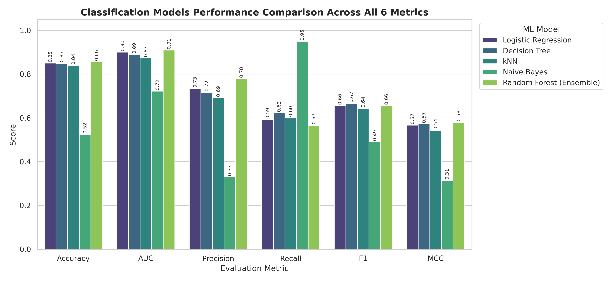
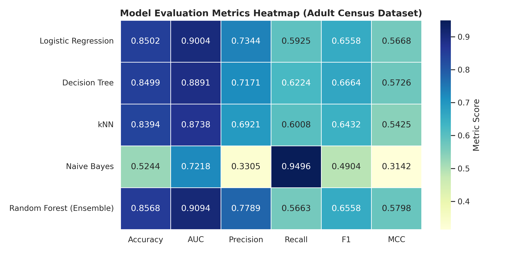

# Machine Learning Assignment-2
## Name: Soorya GS
## BITS-ID: 2026CT05109
# Income Prediction Using Machine Learning Classification Models

## 1. Problem Statement
The objective of this project is to build, evaluate, and compare multiple supervised machine learning classification models to predict whether an individual's annual income exceeds **$50,000** (`>50K`) or is less than or equal to **$50,000** (`<=50K`) based on demographic, educational, and employment attributes. 

Accurate income classification supports socioeconomic policy analysis, financial risk assessment, and targeted resource allocation. Because real-world census data contains missing entries, mixed data types, and class imbalance, this pipeline implements leak-free data preprocessing and evaluates models across six complementary performance metrics—including AUC and Matthews Correlation Coefficient (MCC)—to ensure robust evaluation beyond simple accuracy.

---

## 2. Dataset Description
* **Dataset Name:** Adult Census Income Dataset
* **Source:** UCI Machine Learning Repository / Kaggle (`adult.csv`)
* **Dataset Justification:** Selected because it exceeds all minimum complexity requirements (32,561 raw instances and 14 predictive features), represents a realistic tabular classification problem with mixed numerical and categorical attributes, contains missing values requiring principled imputation, and exhibits natural class imbalance.
* **Instances & Features:**
  * **Raw Instances:** 32,561 rows (32,537 rows remaining after removing 24 exact duplicates)
  * **Predictive Features:** 14 features (exceeding the minimum requirement of 12)
  * **Target Variable:** `income` (Binary classification: `<=50K` mapped to `0`, `>50K` mapped to `1`)

### Feature Types
* **Numerical Features (6):** `age`, `fnlwgt` (final sampling weight), `education.num`, `capital.gain`, `capital.loss`, `hours.per.week`
* **Categorical Features (8):** `workclass`, `education`, `marital.status`, `occupation`, `relationship`, `race`, `sex`, `native.country`

### Missing Values & Class Imbalance Analysis
* **Missing Values:** Missing entries were encoded as `'?'` across three categorical columns: `workclass` (1,836 missing), `occupation` (1,843 missing), and `native.country` (583 missing). These were converted to `NaN` and imputed using the training-set mode.
* **Class Distribution:** The dataset shows a moderate ~3:1 class imbalance:
  * **Class `0` (`<=50K`):** 75.91% (24,698 instances)
  * **Class `1` (`>50K`):** 24.09% (7,839 instances)
  * Because of this imbalance, **MCC**, **F1 Score**, and **AUC** are emphasized alongside Accuracy.

---

## 3. GitHub Repository Link
* **Repository URL:** https://github.com/2026ct05109-svg/ML-Assignment-2
## VM LAB Screenshoots:


## Models Used & Evaluation Metrics Comparison

| ML Model Name | Accuracy | AUC | Precision | Recall | F1 | MCC |
| :--- | :---: | :---: | :---: | :---: | :---: | :---: |
| **Logistic Regression** | 0.8502 | 0.9004 | 0.7344 | 0.5925 | 0.6558 | 0.5668 |
| **Decision Tree** | 0.8499 | 0.8891 | 0.7171 | 0.6224 | 0.6664 | 0.5726 |
| **kNN** | 0.8394 | 0.8738 | 0.6921 | 0.6008 | 0.6432 | 0.5425 |
| **Naive Bayes** | 0.5244 | 0.7218 | 0.3305 | 0.9496 | 0.4904 | 0.3142 |
| **Random Forest (Ensemble)** | **0.8568** | **0.9094** | **0.7789** | 0.5663 | 0.6558 | **0.5798** |

### Graph Representation of Evaluation Metrics



## Observations on Model Performance

| ML Model Name | Observation about model performance |
| :--- | :--- |
| **Logistic Regression** | Achieved strong baseline performance (**Accuracy: 0.8502**, **AUC: 0.9004**, **MCC: 0.5668**). Feature scaling (`StandardScaler`) and One-Hot Encoding enabled the linear decision boundary to separate high-income indicators (such as `capital.gain`, `education.num`, and managerial occupations) effectively, ranking second overall in AUC and Precision. |
| **Decision Tree** | Delivered competitive results (**Accuracy: 0.8499**, **AUC: 0.8891**) and achieved the highest balanced **F1 Score (0.6664)** and second-highest **MCC (0.5726)** among all models. Restricting `max_depth=10` prevented overfitting while capturing non-linear threshold rules (e.g., capital gains and marital status splits), yielding better recall (0.6224) on the minority `>50K` class than Logistic Regression or Random Forest. |
| **kNN** | Recorded solid accuracy (**0.8394**) and AUC (**0.8738**) with `n_neighbors=11`, but trailed tree-based and linear models in F1 (**0.6432**) and MCC (**0.5425**). After One-Hot Encoding expanded the dataset to 104 dimensions, Euclidean distance suffered moderately from the curse of dimensionality and the 3:1 class imbalance. |
| **Naive Bayes** | Exhibited the lowest overall accuracy (**0.5244**), precision (**0.3305**), and MCC (**0.3142**), despite achieving an unusually high recall (**0.9496**). Gaussian Naive Bayes assumes feature independence and normal distributions; both assumptions are heavily violated by sparse One-Hot Encoded binary features and skewed variables like `capital.gain`, causing aggressive over-prediction of the positive (`>50K`) class. |
| **Random Forest (Ensemble)** | Achieved the strongest overall classification performance, ranking #1 in **Accuracy (0.8568)**, **AUC (0.9094)**, **Precision (0.7789)**, and **MCC (0.5798)**. By aggregating 150 decision trees (`max_depth=16`), the ensemble reduced variance compared to the single Decision Tree and minimized false positives on high-income predictions. |
| **Overall Winner for your dataset?** | **Random Forest (Ensemble)** is the overall winner for the Adult Census Income dataset. It achieved the highest **AUC (0.9094)**, highest **Accuracy (0.8568)**, highest **Precision (0.7789)**, and highest **MCC (0.5798)**—the most reliable single metric for imbalanced binary classification—demonstrating superior generalization across high-dimensional mixed census features. |
### Repository Structure
```text
project-folder/
├── requirements.txt
├── README.md
├── test_data.csv
├── metrics_comparison_bar.png
├── metrics_comparison_heatmap.png
└── model/
    ├── train_and_evaluate.py
    ├── preprocessor.joblib
    ├── logistic_regression.joblib
    ├── decision_tree.joblib
    ├── knn.joblib
    ├── naive_bayes.joblib
    ├── random_forest_ensemble.joblib
    └── evaluation_metrics.csv


    └── evaluation_metrics.csv
